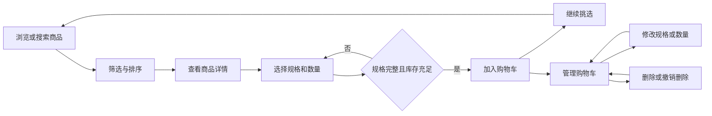

# 海外消费者商品选购应用 PRD v0.1 初稿

本产品帮助海外消费者浏览和筛选商品、理解商品差异，并管理自己的待购清单。首版围绕“发现商品 → 查看详情 → 选择规格 → 加入购物车 → 调整购物车”形成完整体验。

版本：v0.1 初稿  
日期：2026年10月10日  
读者：产品、设计、前端、后端与测试  
状态：用于范围评审和后续原型设计；下列默认假设可调整。

## 产品目标与范围假设

| 项目 | 首版定义 |
| --- | --- |
| 核心目标 | 用户能看懂商品、找到符合条件的商品，并准确管理待购商品 |
| 产品形态 | React 响应式 Web 应用，覆盖手机、平板和 PC 浏览器 |
| 目标用户 | 使用英语购物的海外消费者，支持游客直接浏览和加购 |
| 商品类型 | 暂按单商家销售的一般实物商品设计，支持颜色、尺寸等规格 |
| 语言和货币 | 首版英文界面、USD 价格；文案和金额格式预留国际化能力 |
| 市场与配送 | 首发国家待确认；配送范围、时效与退货说明由业务提供真实数据 |
| 首版闭环 | 完成商品选购与购物车管理 |
| 交易范围 | 支付、下单、地址、订单和物流追踪暂列后续范围，待业务确认 |

本版是选购 MVP。若首版上线目标包含实际销售，则结算与订单能力必须另行纳入上线范围，不能以本 PRD 的完成代表交易系统完成。

## 用户与使用场景

| 用户场景 | 用户需要 | 产品应提供的结果 |
| --- | --- | --- |
| 随意浏览 | 快速了解有什么值得选购 | 图片清晰，标题、价格、关键卖点易扫读 |
| 带条件寻找商品 | 找到符合用途、预算和规格的商品 | 搜索、分类、筛选与排序有效，条件可见且可撤销 |
| 加购前确认 | 确认规格、价格和库存，了解配送信息 | 当前选择明确，缺少必选项时有就近提示 |
| 调整待购清单 | 修改数量或规格、移除不需要的商品 | 金额及时更新，操作有反馈，错误可恢复 |
| 中途离开后返回 | 继续之前的挑选 | 同一浏览器恢复购物车，列表返回位置得到保留 |

以上为设计假设，后续通过代表性用户任务测试验证，不视为已经完成的用户研究。

## 功能优先级

P0 为首版验收项；P1 为核心体验稳定后再排期的增强项；后续范围需另行立项。

| 优先级 | 模块 | 范围 |
| --- | --- | --- |
| P0 | 商品列表 | 商品卡片、搜索、分类、价格与库存筛选、排序、分页 |
| P0 | 商品详情 | 图集、主要信息、规格选择、数量选择、库存状态、加购 |
| P0 | 购物车 | 查看、修改数量、修改规格、合并同规格商品、删除、恢复误删、金额汇总 |
| P0 | 状态恢复 | 同浏览器购物车持久化，保留列表查询条件与返回位置 |
| P0 | 响应式与可用性 | 手机和 PC 布局、键盘操作、加载与错误反馈、英文文案 |
| P0 | 数据与观测 | 商品与 SKU 数据契约，浏览、加购、购物车修改事件 |
| P1 | 选购增强 | 收藏、商品对比、最近浏览、相关推荐、尺码辅助 |
| 后续 | 交易与账户 | 登录、跨设备同步、结算支付、订单、优惠券 |
| 后续 | 市场扩展 | 多语言、多币种、按国家定价与配送规则、用户评价体系 |

首版直接进入商品列表，不单独建设大型营销首页。没有可用功能的入口不出现在导航中。

## 信息架构与核心流程

首版包含商品列表页、商品详情页和独立购物车页。全局导航提供品牌入口、搜索和带数量的购物车入口；配送与退货说明可从详情页和页脚访问。

用户从详情页返回列表时，应保留搜索词、筛选条件、排序、页码和滚动位置。加购成功后留在当前页面，展示成功反馈及“View cart”入口，用户可以继续挑选。

## 商品列表需求

| 编号 | 需求 | 交互与规则 |
| --- | --- | --- |
| PL01 | 商品卡片 | 显示主图、英文名称、当前售价与币种、1 至 2 条关键属性；属性按品类配置 |
| PL02 | 价格呈现 | 单一售价直接展示；不同规格价格不同时展示“From US$…”；有效促销才展示原价与优惠信息 |
| PL03 | 状态呈现 | 全部规格缺货时显示“Out of stock”；部分规格有货时可进入详情选择 |
| PL04 | 搜索 | 按商品名称和已配置关键词搜索；回车或搜索按钮提交，去除首尾空格；空关键词恢复全部结果 |
| PL05 | 分类与筛选 | 分类单选，最低和最高价格可组合，支持“In stock only”；不同筛选维度同时生效 |
| PL06 | 排序 | 默认 Featured，支持 Price: low to high、Price: high to low、Newest；搜索结果默认 Relevance |
| PL07 | 查询反馈 | 显示结果数量和已选条件；支持单独移除条件及 Clear all；查询变化后返回第 1 页 |
| PL08 | 结果加载 | 每页 24 件商品，提供分页；查询条件、排序和页码可通过 URL 恢复 |
| PL09 | 空与错误状态 | 无结果时提供调整条件入口；请求失败时提供 Retry 并保留查询条件 |
| PL10 | 进入详情 | 卡片可通过鼠标、触控和键盘打开对应商品；首版统一在详情页完成加购 |

价格筛选与价格排序使用商品当前可售规格的最低售价；若没有可售规格，使用仍在售目录中的最低展示价并标记缺货。默认列表保留缺货商品，开启库存筛选后排除全部缺货商品。

最低价大于最高价时给出字段提示，不提交无效条件。搜索与筛选同时存在时共同约束结果。没有真实评分或销量来源时不展示评分、评价数量或销量标签。

## 商品详情需求

详情页优先呈现“这是什么、适不适合我、多少钱、能否购买”。PC 首屏采用图集与购买信息双栏；手机依次呈现图集、名称与价格、关键卖点、规格和购买操作。

| 编号 | 需求 | 交互与规则 |
| --- | --- | --- |
| PD01 | 图片与介绍 | 提供主图、细节图和场景图；支持切换与放大；说明材质、尺寸、用途和包装内容 |
| PD02 | 规格选择 | SKU 指一个可购买的规格组合；多选项时不替用户默认决定规格，唯一可选组合可自动选中 |
| PD03 | 规格联动 | 不存在的组合不可选；缺货组合可识别；切换后同步图片、价格和库存，保留仍兼容的选择 |
| PD04 | 数量 | 仅接受正整数；最低为 1，上限为库存与业务限购数中的较小值；无业务限购时仅受库存约束 |
| PD05 | 加购 | 必选规格齐全且可售时允许提交；缺规格时提示具体选项并定位；缺货时禁用且说明原因 |
| PD06 | 加购反馈 | 提交中按钮显示 Adding… 并防止重复提交；成功后显示商品及所选规格、更新购物车角标 |
| PD07 | 加购失败 | 展示可理解的失败原因并允许重试；保留规格和数量，失败操作不改变购物车 |
| PD08 | 配送与退货 | 展示适用市场、运费说明、预计时效及退货入口；只有真实数据才能形成具体承诺 |

加购校验以购物车中该 SKU 已有数量加本次新增数量为准。若超过可购买上限，明确提示还能添加多少，不静默截断数量。

每个详情 URL 可直接打开。商品不存在或已下架时展示明确状态和“Continue shopping”入口。

## 购物车需求

购物车包含商品明细、可计价商品小计、费用说明和“Continue shopping”。首版不显示无法完成实际交易的 Checkout 或 Buy now 按钮。

| 编号 | 功能 | 规则 |
| --- | --- | --- |
| CT01 | 明细展示 | 展示缩略图、名称、所选规格、单价、数量、行金额、库存与失效状态；名称链接到详情 |
| CT02 | 数量调整 | 支持加减和直接输入；提交整数后更新金额；无效输入失焦时恢复上次有效值并说明原因 |
| CT03 | 数量下限 | 数量为 1 时禁用减号；删除使用明确的 Remove 操作 |
| CT04 | 规格修改 | 通过 Change options 打开规格选择层；保存后更新规格、图片、单价和库存 |
| CT05 | 同规格合并 | 同一 SKU 只保留一行；重复加购或改成已存在的 SKU 时数量相加 |
| CT06 | 合并超限 | 合并后的数量超过库存或限购时阻止保存，展示允许数量，保持原行不变 |
| CT07 | 删除与撤销 | 单项 Remove 后立即更新清单，显示 5 秒 Undo；撤销时恢复原规格和数量并重新校验 |
| CT08 | 金额汇总 | 行金额为当前单价乘有效数量；商品小计为所有有效行金额之和 |
| CT09 | 空购物车 | 展示“Your cart is empty”和 Continue shopping；无无意义的零金额操作区 |
| CT10 | 持久化 | 游客购物车保存到同一浏览器，刷新和重新打开后可恢复；有效操作后保留 30 天 |
| CT11 | 保存失败 | 本地存储不可用时保留当前页面会话并提示无法长期保存；服务写入失败时恢复上次确认状态 |
| CT12 | 角标 | 购物车入口显示保留商品的数量之和，不是商品行数；含失效行时在购物车内另标“需要处理”的数量 |

首版所有有效行共同计入商品小计，不提供勾选部分商品结算或清空全部的额外控制。编辑和删除已经覆盖本轮购物车管理需求。

费用区始终使用“Subtotal”，并标明 USD。运费与税费未确定时展示“Shipping and taxes are not included in this subtotal.”，不能显示为 0 或暗示已含全部费用。金额采用货币最小单位计算，避免小数累计误差；原价不参与实际小计。

购物车不预留库存。进入或恢复购物车、修改数量或规格以及加购时均需校验最新价格与库存。失效行的处理如下：

| 变化 | 用户看到的内容 | 金额处理 |
| --- | --- | --- |
| 商品降价或涨价 | 显示最新价格与“Price updated”，说明原价和现价 | 使用最新价格重新计算 |
| 全部缺货或商品下架 | 保留商品行并标记不可购买，提供移除或更换规格入口 | 排除该行，注明小计仅含有效商品 |
| 请求数量超过最新库存 | 显示可用上限和“调整为可用数量”的明确操作 | 确认调整前排除该行 |
| 价格或库存暂时无法校验 | 保留历史信息并标记待更新，提供重试 | 不把旧值作为已确认小计；费用区显示待确认 |

购物车只在当前浏览器内恢复，不承诺跨设备同步。重复点击、请求重试不得产生重复加购；快速连续修改数量时，以用户最后一次被确认的操作为结果。

## 移动端与 PC 设计要求

设计方向为商品图片占主要视觉空间、信息层级清楚、操作反馈直接。颜色与字体在后续视觉方案中确定；选中、缺货和错误状态同时使用文字或图标，不能只依赖颜色。

| 项目 | 手机 320 至 767 px | 平板 768 至 1023 px | PC 1024 px 及以上 |
| --- | --- | --- | --- |
| 商品列表 | 320 至 359 px 一列，其余两列 | 默认三列 | 默认四列，内容宽度上限 1440 px |
| 搜索 | 显眼输入入口，软键盘提交可用 | 顶部搜索 | 顶部常驻搜索 |
| 筛选 | 底部面板或全屏面板，提供 Apply 和 Clear all | 抽屉面板 | 侧栏或工具栏 |
| 详情 | 单列，规格易触达，底部固定加购区 | 依据内容空间单列或双列 | 图集与购买信息双栏 |
| 购物车 | 商品卡片纵向排列，底部显示简洁小计 | 列表与汇总适配空间 | 左侧明细、右侧汇总 |
| 操作反馈 | 加购提示、数量反馈不遮挡主操作 | 与手机逻辑一致 | 支持鼠标和键盘操作 |

断点是首版布局约定，可依据真实内容调整；所有尺寸共享业务规则。筛选面板中的修改在 Apply 前为草稿，关闭面板不改变当前结果。

交互目标：主要触控区域至少 44 × 44 px；正文一般不小于 16 px；长英文名称可换行，商品卡片最多显示两行、详情展示完整名称。320 px 宽度下无页面级横向滚动。固定底栏为内容预留空间并适配安全区，不能遮住最后一行商品或错误提示。

所有核心功能不依赖 hover。Tab 顺序符合阅读顺序，焦点可见；弹层打开后焦点进入弹层，关闭后回到触发位置；图片提供有意义的替代文本，数量变化与错误反馈可被辅助技术识别。

## 页面状态与内容规范

| 状态 | 处理要求 |
| --- | --- |
| 初次加载 | 使用与最终布局一致的骨架或进度反馈，避免价格和按钮跳动 |
| 图片失败 | 保留图片位置，显示明确替代内容；名称、价格和操作仍可使用 |
| 网络超时或离线 | 说明无法更新的内容并提供重试，保留用户已输入的条件与规格 |
| 无商品或无搜索结果 | 区分目录为空与筛选无结果，给出相应的返回或清除入口 |
| 操作进行中 | 标明进行中状态，同一操作防止重复提交，页面其他可用区域仍可操作 |
| 商品失效 | 明确下架、缺货或信息待更新，避免统一显示为“出错了” |

界面使用简洁英文，包括 Add to cart、View cart、Remove、Undo、Continue shopping。尺寸与重量必须带单位；适用品类可同时展示公制和英制，尺码保留品牌原始定义，不凭空换算。

商品必须有可用主图、英文名称、真实售价、SKU、可售状态及关键参数。促销、免运费、限量、原价和评分需要真实依据。用于原型的数据须标明为演示数据。

## 数据与开发边界

前端采用 React，建议结合 TypeScript 约束商品与购物车数据。组件按搜索与筛选、商品卡片、图集、规格选择、数量控件、购物车行和金额汇总拆分，移动端与 PC 复用同一业务状态。

| 数据对象 | 最少需要的信息 |
| --- | --- |
| 商品 | productId、slug、英文名称、描述、分类、图集、关键参数、状态 |
| SKU | skuId、productId、规格组合、单价、币种、可选原价、库存或可售上限、状态、可选规格图片 |
| 购物车行 | skuId、数量、添加时间、用于恢复的展示快照 |
| 校验结果 | 最新价格、可售上限、有效性、失败原因、更新时间 |
| 列表响应 | 商品列表、总结果数、页码、分页大小、可用筛选项 |

购物车持久化存储身份和数量，展示快照仅用于恢复体验；真实价格、库存和可售状态以商品服务的最新响应为准。前端金额计算不能取代后续交易服务的最终报价。

原型阶段可使用模拟商品与本地购物车验证交互。真实上线需要商品数据、库存、价格、配送与退货内容、图片资源和监测服务；这两种交付状态必须区分。

性能验收建议采用约定的中端手机与模拟移动网络条件，首次可用商品内容在 3 秒内出现、操作在 100 毫秒内提供视觉反馈；以上为待验证的工程预算。图片应按显示尺寸加载并延迟加载非首屏内容。浏览器验证覆盖上线时的 Chrome、Safari、Edge 当前与前一主版本，以及 iOS Safari 和 Android Chrome。

## 关键验收用例

| 编号 | 场景 | 通过标准 |
| --- | --- | --- |
| AC01 | 搜索并设置价格与库存条件 | 所有结果同时满足条件；结果数量正确；清除后恢复；无结果可自行恢复 |
| AC02 | 从列表进入详情再返回 | 查询条件、排序、页码和滚动位置保留 |
| AC03 | 缺少必选规格时加购 | 指出缺少的规格，不新增购物车行；选择完成后可正常加购 |
| AC04 | 连续两次添加同一 SKU | 合并为一行且数量正确；双击或网络重试不会重复提交同一次操作 |
| AC05 | 修改成购物车已有规格 | 数量正确合并；超过库存时保留修改前状态并说明原因 |
| AC06 | 输入 0、负数、小数、字母或超库存数 | 无效数量不写入购物车；提供就近提示并保留可恢复状态 |
| AC07 | 金额计算 | 演示单价 US$19.99 × 3 与 US$5.50 × 2，小计精确为 US$70.97 |
| AC08 | 删除及撤销 | 删除后数量和小计同步更新；5 秒内撤销可恢复，并校验当前有效性；删光后进入空状态 |
| AC09 | 刷新或重新打开页面 | 30 天有效期内恢复同浏览器购物车，并重新校验商品信息；存储不可用有明确提示 |
| AC10 | 价格、库存或上架状态变化 | 按失效规则显示原因与操作；不可购买的行不计入有效商品小计 |
| AC11 | 请求失败或快速操作 | 加购失败不增加数量；修改失败可恢复；快速修改不会被过期响应覆盖 |
| AC12 | 不同设备与输入方式 | 在 320、390、768、1024、1440 px 宽度完成核心流程，无遮挡与横向溢出，键盘可完成全部核心操作 |
| AC13 | 金额与内容真实性 | 英文文案和 USD 标识一致；运费税费未确定时不显示为免费，不出现无依据评分或促销 |

首版交付条件为所有 P0 功能可用、以上用例通过，并且正常、空、加载、失败和库存变化状态均可演示。

## 成功指标与验证方式

核心验证是用户能否独立完成“找到符合条件的商品 → 选对规格 → 加入购物车 → 修改数量或规格 → 移除商品 → 返回继续挑选”。

| 指标 | 统计口径 | 用途 |
| --- | --- | --- |
| 核心任务完成率 | 完成上述全流程的人数 / 开始任务的人数 | 上线前建议先测试 5 至 8 名代表性用户；完成率目标至少 80%，只作为形成性验证 |
| 详情到加购率 | 发生成功加购的详情访问会话数 / 全部详情访问会话数 | 按设备、品类和流量来源观察，收集基线后设目标 |
| 加购操作成功率 | 成功完成的有效加购操作数 / 已提交的有效加购操作数 | 识别请求、校验和状态同步问题；同一操作重试去重 |
| 购物车编辑成功率 | 成功完成的有效编辑操作数 / 已提交的有效编辑操作数 | 观察数量、规格和删除操作的可靠性 |
| 恢复正确率 | 正确恢复且完成重新校验的测试次数 / 全部恢复测试次数 | 验证持久化与旧数据处理 |

最少记录 view_item_list、select_item、view_item、search、filter_apply、add_to_cart、view_cart、update_cart_item、remove_from_cart 及对应失败事件。事件包含商品或 SKU、数量、币种、设备类别、结果和错误类别；成功事件只在操作确认成功后记录。

统一采用 30 分钟无活动划分会话，并按会话去重计算漏斗。业务转化目标在真实数据形成基线后确定；首版不使用支付转化率衡量未纳入的支付能力。

## 待确认事项与下一步

| 待确认项 | 当前默认 | 对后续设计的影响 |
| --- | --- | --- |
| 首发品类 | 一般实物商品 | 决定关键卖点、规格、筛选项、尺寸说明和图片比例 |
| 首发国家 | 未指定，英文与 USD 用于初稿 | 决定货币、计量单位、配送与费用说明 |
| 首版是否需要真实交易 | 先完成选购和购物车 | 决定是否增加地址、结算、支付、订单与服务端能力 |
| 商品数据来源 | 原型模拟、上线接真实服务 | 决定数据准备、库存校验和接口工作量 |
| 品牌与视觉方向 | 清晰、简洁、突出商品 | 决定字体、配色、图片风格与组件细节 |

建议下一步先确认首发品类、目标国家和是否包含真实交易，再基于本 PRD 设计商品列表、商品详情和购物车的 PC 与移动端原型。

